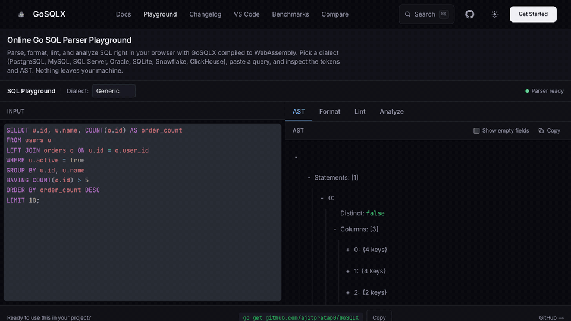
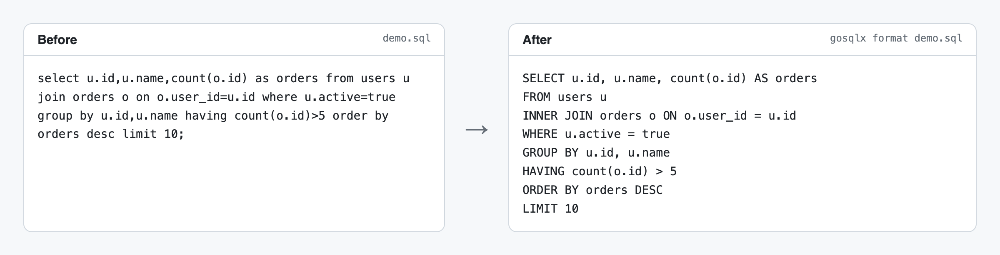

<div align="center">


# GoSQLX

**Pure-Go SQL parser, formatter, linter and security scanner for 8 dialects.**

[](https://github.com/ajitpratap0/GoSQLX/actions/workflows/test.yml)
[](https://pkg.go.dev/github.com/ajitpratap0/GoSQLX)
[](https://github.com/ajitpratap0/GoSQLX/releases)
[](LICENSE)
[](https://securityscorecards.dev/viewer/?uri=github.com/ajitpratap0/GoSQLX)

**[Playground](https://gosqlx.dev/playground/)** &nbsp;·&nbsp; **[Docs](https://gosqlx.dev/docs/)** &nbsp;·&nbsp; **[Benchmarks](https://gosqlx.dev/benchmarks/)** &nbsp;·&nbsp; **[VS Code](https://marketplace.visualstudio.com/items?itemName=ajitpratap0.gosqlx)** &nbsp;·&nbsp; **[MCP server](#mcp-server)**

<br/>

<!-- metrics:start -->
| **~2.9M parses/sec†** | **349 ns parse latency†** | **~80–85% SQL-99 (est.)** | **8 dialects** | **0 race conditions** |
|:---:|:---:|:---:|:---:|:---:|

<sub>† Parse stage only (pre-tokenized input to AST), `SELECT id, name FROM users`, Apple M4, Go 1.27, median of 20 runs of `BenchmarkPerformanceBaseline`. Complex queries take longer (see `performance_baselines.json`). Reproduce: `go test -run ^$ -bench BenchmarkPerformanceBaseline -benchmem -count=20 ./pkg/sql/parser/`.</sub>
<!-- metrics:end -->

<br/>



</div>

<br/>

## What is GoSQLX?

GoSQLX is a **production-ready SQL parsing SDK** for Go. It tokenizes, parses, and generates ASTs from SQL with zero-copy optimizations and intelligent object pooling - parsing a simple SELECT in about <!-- metrics-inline:start -->**349 ns (~2.9M parses/sec)**<!-- metrics-inline:end -->.

### Why GoSQLX?

- **Not an ORM** - a parser. You get the AST, you decide what to do with it.
- **Not slow** - zero-copy tokenization, sync.Pool recycling, no allocations on hot paths.
- **Not limited** - PostgreSQL, MySQL, MariaDB, SQL Server, Oracle, SQLite, Snowflake, ClickHouse. CTEs, window functions, MERGE, set operations.
- **Not just a library** - CLI, VS Code extension, GitHub Action, MCP server, WASM playground, Python bindings.

<br/>

## Install

### Go library

```bash
go get github.com/ajitpratap0/GoSQLX
```

### CLI

```bash
go install github.com/ajitpratap0/GoSQLX/cmd/gosqlx@latest
```

### VS Code

```bash
code --install-extension ajitpratap0.gosqlx
```

The extension bundles the binary, so there is no extra setup. [Learn more](https://gosqlx.dev/vscode/).

### MCP server

```bash
claude mcp add --transport http gosqlx https://mcp.gosqlx.dev/mcp
```

7 SQL tools in Claude, Cursor, or any MCP client. [MCP guide](https://gosqlx.dev/docs/integrations/mcp/).

**Claude Code plugin** (skills, slash commands, SQL reviewer agent): `/plugin marketplace add ajitpratap0/GoSQLX` then `/plugin install gosqlx@gosqlx` - [details](plugins/gosqlx/README.md).

**ChatGPT app**: add `https://mcp.gosqlx.dev/mcp` as a connector in developer mode for an interactive analysis widget - [details](integrations/chatgpt/README.md).

[](https://mcp.gosqlx.dev/health)
[](https://glama.ai/mcp/servers/ajitpratap0/GoSQLX)

### GitHub Action

```yaml
- uses: ajitpratap0/GoSQLX@v1
  with:
    files: '**/*.sql'
    validate: true
```

<br/>

## Quick start

Source: [`examples/readme_quickstart/main.go`](examples/readme_quickstart/main.go), compiled in CI against HEAD and the latest release.

```go
package main

import (
	"context"
	"errors"
	"fmt"
	"log"

	"github.com/ajitpratap0/GoSQLX/pkg/gosqlx"
	"github.com/ajitpratap0/GoSQLX/pkg/sql/ast"
)

func main() {
	ctx := context.Background()

	// ParseTree is the recommended entry point. It returns an
	// opaque handle with built-in helpers.
	tree, err := gosqlx.ParseTree(ctx, "SELECT id, name FROM users WHERE active = true",
		gosqlx.WithDialect("postgresql"))
	if err != nil {
		// Sentinel errors work with errors.Is
		if errors.Is(err, gosqlx.ErrSyntax) {
			log.Fatalf("syntax error: %v", err)
		}
		log.Fatal(err)
	}
	fmt.Println("Tables:", tree.Tables())
	fmt.Println(tree.Format(gosqlx.WithIndent(2), gosqlx.WithUppercaseKeywords(true)))

	// Walk the AST - typed walkers avoid the type-assertion dance:
	tree.WalkSelects(func(s *ast.SelectStatement) bool {
		fmt.Printf("  SELECT with %d columns\n", len(s.Columns))
		return true
	})

	// The legacy Parse/Format/Validate API still works for v1.x code.
	// See docs/MIGRATION.md for the Tree migration guide.
}
```

Output:

```text
Tables: [users]
SELECT id, name
FROM users
WHERE active = true
  SELECT with 2 columns
```

Formatting turns one-line SQL into a readable query:

<picture>
  <source media="(prefers-color-scheme: dark)" srcset=".github/assets/format-before-after-dark.png">
  
</picture>

<br/>

## Features

<picture>
  
</picture>

- **[Parser](https://gosqlx.dev/docs/concepts/architecture/)** - zero-copy tokenizer, recursive descent parser and full AST generation.
- **[Analysis](https://gosqlx.dev/docs/reference/linting-rules/)** - SQL injection scanner, 30 lint rules (L001-L030), 20 optimizer rules and metadata extraction.
- **[Tooling](https://gosqlx.dev/docs/cli-guide/)** - AST-based formatter, query transforms API, VS Code extension and GitHub Action.
- **[Syntax highlighting](docs/HIGHLIGHTING.md)** - dialect-aware highlighting for terminals (ANSI), HTML/CSS, JSON spans, LSP semantic tokens and WASM; `gosqlx highlight query.sql` or `gosqlx.HighlightANSI(sql)`.
- **[Multi-dialect](https://gosqlx.dev/docs/reference/sql-compatibility/)** - 8 dialects with dedicated grammar support: PostgreSQL, MySQL, MariaDB, SQL Server, Oracle, SQLite, Snowflake, ClickHouse. The `--dialect` flag and `WithDialect` accept 11 names: those 8 (`postgresql`, `mysql`, `mariadb`, `sqlserver`, `oracle`, `sqlite`, `snowflake`, `clickhouse`) plus `generic`, `bigquery` and `redshift`. BigQuery and Redshift have no dialect-specific keyword set (they use the generic keywords) and only capability-gated grammar, such as BigQuery's `QUALIFY`, `PIVOT`/`UNPIVOT`, `UNNEST` in `FROM` and `(struct).field` access.
- **[AI-ready](https://gosqlx.dev/docs/integrations/mcp/)** - MCP server with 7 tools, public remote endpoint, Streamable HTTP.
- **[Tested](https://gosqlx.dev/docs/reference/sql-compatibility/)** - race-detector clean in CI, ~80-85% SQL-99 (estimated).

<br/>

## Documentation

- **[Getting Started](https://gosqlx.dev/docs/getting-started/)** - parse your first SQL in 5 minutes
- **[Usage Guide](https://gosqlx.dev/docs/usage-guide/)** - comprehensive patterns and examples
- **[API Reference](https://gosqlx.dev/docs/reference/api/)** - complete API documentation
- **[CLI Guide](https://gosqlx.dev/docs/cli-guide/)** - command-line tool reference
- **[SQL Compatibility](https://gosqlx.dev/docs/reference/sql-compatibility/)** - dialect support matrix
- **[MCP Guide](https://gosqlx.dev/docs/integrations/mcp/)** - AI assistant integration
- **[Architecture](https://gosqlx.dev/docs/concepts/architecture/)** - system design deep-dive
- **[Benchmarks](https://gosqlx.dev/benchmarks/)** - performance data and methodology
- **[Changelog](CHANGELOG.md)** - what changed in each version

<br/>

## Contributing

GoSQLX is built by contributors like you. Whether it's a bug fix, new feature, documentation improvement, or just a typo - every contribution matters.

```bash
git clone https://github.com/ajitpratap0/GoSQLX.git && cd GoSQLX
task check    # fmt → vet → lint → test (with race detection)
```

1. **Fork & branch** from `main`
2. **Write tests** - we use TDD and require race-free code
3. **Run `task check`** - must pass before PR
4. **Open a PR** - we review within 24 hours

[Contributing Guide](CONTRIBUTING.md) · [Code of Conduct](CODE_OF_CONDUCT.md) · [Governance](GOVERNANCE.md)

<br/>

## Community

Questions or ideas: [Discussions](https://github.com/ajitpratap0/GoSQLX/discussions). Found a bug or want a feature: [Issues](https://github.com/ajitpratap0/GoSQLX/issues/new/choose).

<br/>

## License

Apache License 2.0 - see [LICENSE](LICENSE) for details.

---

<div align="center">

**[gosqlx.dev](https://gosqlx.dev)** · **[Playground](https://gosqlx.dev/playground/)** · **[Docs](https://gosqlx.dev/docs/)** · **[MCP Server](https://gosqlx.dev/docs/integrations/mcp/)** · **[VS Code](https://marketplace.visualstudio.com/items?itemName=ajitpratap0.gosqlx)**

</div>
